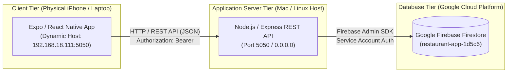
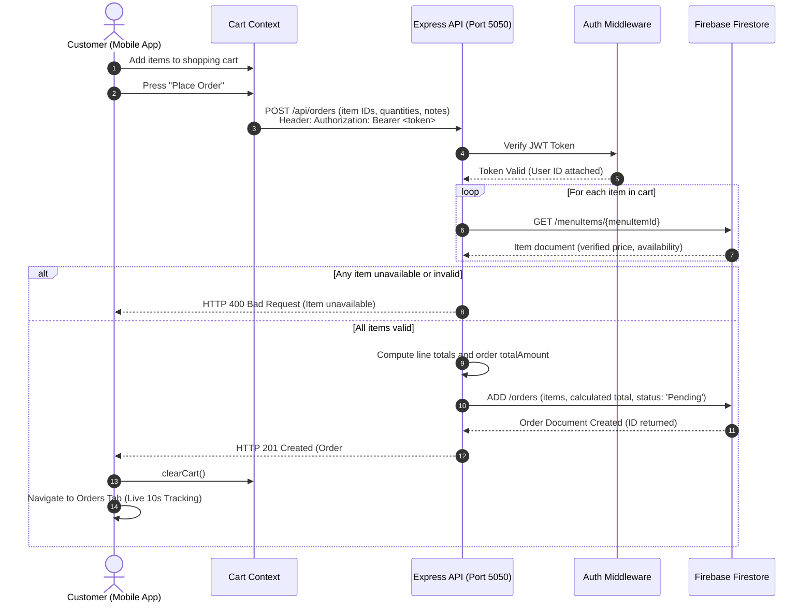

# Software Requirements Specification (SRS v2.0)
## RestaurantApp — Food Ordering & Table Reservation System (Firebase Edition)

---

### Document Information
- **Project Name:** RestaurantApp
- **Version:** 2.0 (Final Submission — Firebase Only)
- **Target Platforms:** iOS & Android (Expo Router / React Native)
- **Backend Architecture:** Node.js / Express REST API (Port 5050)
- **Database Engine:** Firebase Firestore (Cloud NoSQL Database)

---

## 1. Project Scope & Scope Changes

### 1.1 Original Scope
The original system specification explored hybrid database options (MongoDB/Mongoose and Firebase). 

### 1.2 Scope Changes (v2.0)
- **Single Source of Truth:** All MongoDB, Mongoose, and mixed-provider dependencies have been **completely removed**. The backend now runs exclusively on **Firebase Admin SDK** and **Firebase Firestore**.
- **Port Alignment:** The backend port is standardized to **Port 5050** as required by the assignment specification.
- **Enhanced Entity Model:** Added first-class Firestore support for `tables`, with table capacities and dining time-window conflict management.
- **Order State Machine:** Enforced the strict state progression: `Pending` → `Preparing` → `Ready` → `Served`, with cancellation permitted only while `Pending`.

---

## 2. Glossary of Terms

1. **RBAC (Role-Based Access Control):** A security mechanism restricting system access based on authenticated user roles (`customer` vs `manager`).
2. **JWT (JSON Web Token):** A compact, URL-safe means of representing claims securely between the mobile client and the Express backend, with a 1-day expiration.
3. **Bcrypt (Cost Factor 12):** An adaptive cryptographic key-derivation function used to securely hash and salt user passwords before storing in Firestore.
4. **Idempotency:** An operation property where repeated execution yields the identical outcome without duplicate records or side effects (implemented in our Firestore seeder).
5. **NoSQL Document Collection:** The organizational paradigm in Firebase Firestore where structured JSON-like documents reside inside collections (`users`, `menuItems`, `tables`, `orders`, `reservations`).
6. **Dining Slot Window:** A calculated time window (±90 minutes) applied to check whether a table reservation overlaps with another booking on the same calendar date.

---

## 3. System Architecture & Diagrams

### 3.1 Deployment Diagram

### 3.2 Sequence Diagram: Customer Places an Order

---

## 4. Firestore Database Design

### 4.1 Collections & Schema
| Collection | Key Fields | Description |
|---|---|---|
| `users` | `_id`, `name`, `email`, `password` (bcrypt hash), `role` (`customer` \| `manager`), `createdAt` | Stores authenticated user accounts. Password hashes never returned in API. |
| `menuItems` | `_id`, `name`, `description`, `category`, `price`, `emoji`, `available`, `createdAt` | Authoritative restaurant menu catalog (18 preloaded items). |
| `tables` | `_id`, `tableNumber`, `capacity`, `location`, `isAvailable` | Physical dining tables (Tables 1 through 6). |
| `orders` | `_id`, `user` (`{ id, name, email }`), `items[{ menuItemId, name, price, quantity }]`, `totalAmount`, `status`, `notes`, `createdAt` | Food orders with server-computed totals. Status: `Pending` → `Preparing` → `Ready` → `Served`. |
| `reservations` | `_id`, `user` (`{ id, name, email }`), `tableNumber`, `date`, `time`, `partySize`, `specialRequests`, `status`, `createdAt` | Table bookings. Enforces capacity and non-overlapping time conflicts. |

---

## 5. API Endpoints (24 Endpoints)

| Method | Endpoint | Access | Purpose |
|---|---|:---:|---|
| `GET` | `/api/health` | Public | System health and database provider verification |
| `POST` | `/api/auth/register` | Public | Register customer account with bcrypt password |
| `POST` | `/api/auth/login` | Public | Authenticate user and issue 1-day JWT Bearer token |
| `GET` | `/api/auth/me` | Customer / Manager | Fetch authenticated user profile |
| `GET` | `/api/menu` | Public | List menu items (supports `?category=` and `?search=`) |
| `GET` | `/api/menu/categories` | Public | Retrieve list of unique categories |
| `GET` | `/api/menu/:id` | Public | Fetch specific dish by Firestore ID |
| `POST` | `/api/menu` | Manager Only | Add new menu item |
| `PUT` | `/api/menu/:id` | Manager Only | Update existing menu item |
| `DELETE` | `/api/menu/:id` | Manager Only | Delete menu item from Firestore |
| `GET` | `/api/tables` | Public | List all dining tables and capacities |
| `GET` | `/api/tables/:tableNumber` | Public | Fetch single table details |
| `POST` | `/api/orders` | Customer / Manager | Place order with server-verified prices |
| `GET` | `/api/orders/my` | Customer Only | Customer views their own orders |
| `GET` | `/api/orders` | Manager (or Own) | List orders (manager views all) |
| `GET` | `/api/orders/:id` | Customer / Manager | View specific order details |
| `PATCH` | `/api/orders/:id/status` | Manager Only | Progress status: `Pending` → `Preparing` → `Ready` → `Served` |
| `DELETE` | `/api/orders/:id` | Customer / Manager | Cancel order (strictly allowed only while `Pending`) |
| `GET` | `/api/reservations/availability` | Customer / Manager | Query table availability (`?date=...&time=...`) |
| `POST` | `/api/reservations` | Customer / Manager | Book a table with capacity check and conflict prevention |
| `GET` | `/api/reservations/my` | Customer Only | Customer views their own reservations |
| `GET` | `/api/reservations` | Manager (or Own) | List reservations (manager views all) |
| `PATCH` | `/api/reservations/:id/status` | Manager Only | Accept/Decline/Confirm reservation |
| `DELETE` | `/api/reservations/:id` | Customer / Manager | Cancel reservation and release table slot |

---

## 6. Verification Summary

- **Automated Tests:** 32 passing integration tests in `server/tests/api.test.js` (`100% Pass Rate`).
- **Frontend Typecheck:** `npx tsc --noEmit` passed with 0 errors.
- **Seeded Data:** 18 menu items, 6 tables, customer and manager demo accounts preloaded into Firebase Firestore.
